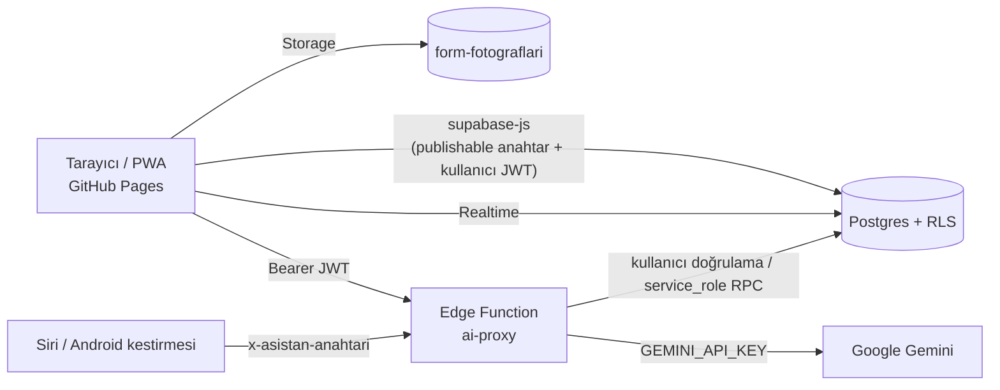
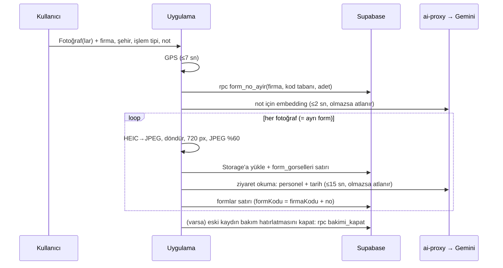

# ENORPA İş Formları — Geliştirme Rehberi

Bu belge, uygulamayı geliştirecek, bakımını yapacak veya yayınlayacak kişi için yazıldı. Kodun nasıl çalıştığını,
nerede ne olduğunu, değişiklik yaparken nelere dikkat edileceğini ve sık yapılan işlerin adım adım nasıl yapılacağını
anlatır. Kısa mimari özet için [ARCHITECTURE.md](ARCHITECTURE.md), kurulum özeti için [README](../README.md).

> Bu depo **herkese açıktır**. Belgeye, koda veya commit mesajlarına kişi e-postası, şifre, API anahtarı ya da
> `service_role` anahtarı yazmayın.

## İçindekiler

1. [Uygulama ne yapar](#1-uygulama-ne-yapar)
2. [Hızlı başlangıç](#2-hızlı-başlangıç)
3. [Teknoloji ve mimari](#3-teknoloji-ve-mimari)
4. [Klasör ve dosya haritası](#4-klasör-ve-dosya-haritası)
5. [Açılış sırası, paylaşılan durum ve `window` işlevleri](#5-açılış-sırası-paylaşılan-durum-ve-window-işlevleri)
6. [Ekranlar ve akışlar](#6-ekranlar-ve-akışlar)
7. [Veri katmanı (`src/veri/`)](#7-veri-katmanı-srcveri)
8. [Veritabanı (Supabase / Postgres)](#8-veritabanı-supabase--postgres)
9. [Kimlik doğrulama, roller ve kullanıcı yönetimi](#9-kimlik-doğrulama-roller-ve-kullanıcı-yönetimi)
10. [Form numarası ve firma kodu](#10-form-numarası-ve-firma-kodu)
11. [Yapay zekâ (Gemini)](#11-yapay-zekâ-gemini)
12. [PWA, önbellekler ve tarayıcıda saklanan veriler](#12-pwa-önbellekler-ve-tarayıcıda-saklanan-veriler)
13. [Testler](#13-testler)
14. [Yayın ve ortamlar](#14-yayın-ve-ortamlar)
15. [Geliştirme tarifleri](#15-geliştirme-tarifleri)
16. [Kod kuralları](#16-kod-kuralları)
17. [Güvenlik](#17-güvenlik)
18. [Sorun giderme](#18-sorun-giderme)
19. [Bilinen sınırlamalar ve teknik borç](#19-bilinen-sınırlamalar-ve-teknik-borç)
20. [Yol haritası önerileri](#20-yol-haritası-önerileri)
21. [Sözlük](#21-sözlük)
22. [Geçmiş: Firebase'den Supabase'e geçiş](#22-geçmiş-firebaseden-supabasee-geçiş)

---

## 1. Uygulama ne yapar

ENORPA teknik servis ekibinin sahada kullandığı, telefona yüklenebilen bir web uygulaması (PWA):

- **Form kaydı (iki yol):**
  - *İş formu tara:* kâğıt formun fotoğrafı çekilir, firma/şehir/işlem tipi/not girilir, konumla kaydedilir.
  - *İş formu oluştur:* uygulama içinde dijital form doldurulur (cihaz, servis türü, saatler, km, personel, imzalar);
    A4 PDF üretilir, cihaza indirilir ve WhatsApp/paylaş menüsüyle gönderilir.
- **Arama:** firma adı, şehir, form/ürün kodu, firma kodu, e-posta; otomatik öneri, tarih filtresi, CSV dışa aktarım.
- **Akış:** son 10 kayıt canlı olarak.
- **Rapor:** Türkiye haritası (il bazında), işlem tipi ve personel grafikleri, CSV.
- **Firma kartı:** yetkili/telefon/adres/notlar, son işlemler, **ENORPA ziyaret geçmişi** (kim, ne zaman, kaç kez).
- **Bakım takibi:** yaklaşan/gecikmiş bakımlar, takvime ekleme (.ics), günlük rota (Google Haritalar).
- **Yapay zekâ:** sohbet asistanı (kayıtlarda arar, sayar, özetler), not düzeltme/kontrol, kâğıt formu okuma, kartvizitten
  firma kartı doldurma, firma özeti, müşteriye mesaj, rapor yorumu, anlamsal (benzer arıza) arama, ziyaret okuma.
- **Yönetim:** kullanıcı rolleri, işlem geçmişi (denetim kaydı), personel listesi, tam yedek (JSON).
- **Sesli asistan:** Siri / Android kestirmesiyle "Enorpa'ya sor".

Roller: **yönetici** (her şey), **düzenleyen** (form ekler, firma kartı ve personel ekler), **görüntüleyen** (yalnızca okur).

---

## 2. Hızlı başlangıç

### Gereksinimler
- Node.js **22** (en az 20.19), npm.
- (İsteğe bağlı) [Supabase CLI](https://supabase.com/docs/guides/cli) — migrasyon ve Edge Function yayını için.
- (İsteğe bağlı) Playwright Chromium — duman testi için: `npx playwright install chromium`.

### Kurulum
```bash
git clone https://github.com/ferhathaciosmanoglu/isform
cd isform
npm ci
```

### Komutlar

| Komut | Ne yapar |
|---|---|
| `npm run dev` | Geliştirme sunucusu, http://localhost:5173 (gerçek Supabase'e bağlanır) |
| `npm run demo` | Supabase'e **bağlanmadan**, bellekteki uydurma verilerle, http://localhost:5174. Herhangi bir e-posta/şifre ile girilir |
| `npm run build` | Üretim derlemesi → `dist/` |
| `npm run preview` | `dist/`'i yerelde sunar |
| `npm run lint` | ESLint |
| `npm test` | Birim testleri (`tests/unit`, node:test) |
| `npm run check` | lint + birim testleri + derleme (PR açmadan önce çalıştırın) |
| `npm run test:smoke` | Gerçek tarayıcıda duman testi (sahte veri katmanıyla) |
| `npm run test:entegrasyon` | Gerçek Supabase'e karşı test (ortam değişkeni ister, bkz. §13) |
| `npm run format` | Prettier (yalnızca istenirse; mevcut kod tek satırlık yoğun stildedir, toplu biçimlendirme büyük diff üretir) |

### Ortam değişkenleri (`.env`, isteğe bağlı)

| Değişken | Varsayılan | Açıklama |
|---|---|---|
| `VITE_SUPABASE_URL` | `src/veri/config.js` | Başka bir Supabase projesine bağlanmak için |
| `VITE_SUPABASE_ANON_KEY` | `src/veri/config.js` | O projenin *publishable* (anon) anahtarı |
| `VITE_AI_PROXY_URL` | `<SUPABASE_URL>/functions/v1/ai-proxy` | Farklı bir AI proxy kullanılacaksa |

`.env` dosyası `.gitignore`'dadır. Publishable anahtar gizli değildir (tarayıcıya zaten iner); güvenlik RLS ile sağlanır.

### Yerelde giriş
`npm run dev` ile açılan uygulama **gerçek** veritabanını kullanır; yaptığınız kayıtlar canlı veriye yazılır.
Deneme yapacaksanız `npm run demo` kullanın. Yerel adresin Supabase'de **Redirect URLs** listesinde
(`http://localhost:5173/**`) olması gerekir, yoksa şifre sıfırlama bağlantıları çalışmaz (bkz. §18).

---

## 3. Teknoloji ve mimari

| Katman | Teknoloji |
|---|---|
| Ön yüz | Düz JavaScript (ES modülleri), framework yok; Vite 6 ile derlenir |
| Biçim | Elle yazılmış CSS (`src/styles/`), CSS değişkenleri ile açık/koyu tema |
| Kimlik | Supabase Auth (e-posta + şifre) |
| Veritabanı | Supabase Postgres + Row Level Security (RLS) |
| Dosya | Supabase Storage (`form-fotograflari`, özel bucket) |
| Canlı veri | Supabase Realtime (`formlar` tablosu) |
| Sunucu kodu | Supabase Edge Function `ai-proxy` (Deno) |
| Yapay zekâ | Google Gemini (metin, görüntü, embedding) — yalnızca Edge Function üzerinden |
| PDF | jsPDF + html2canvas (ilk kullanımda yüklenir) |
| iPhone fotoğrafı | heic2any (yalnızca HEIC seçilince yüklenir) |
| Barındırma | GitHub Pages (`https://ferhathaciosmanoglu.github.io/isform/`) |
| CI | GitHub Actions (`ci.yml`, `yayin.yml`) |



Temel tasarım kararları:
- **Sunucu yok, istemci + RLS var.** Tüm iş kuralları ya tarayıcıda ya da veritabanı politikalarında/fonksiyonlarında.
  Tarayıcıdaki rol kontrolleri yalnızca görünüm içindir; asıl yetki **RLS**'tedir.
- **Firestore benzeri veri API'si.** Uygulama Firebase ile yazılmıştı; geçişte çağrı yerleri değiştirilmesin diye
  `src/veri/firestore.js` aynı API'yi Supabase üzerinde sunar (§7). Yeni kodda da bu API kullanılır.
- **Gemini anahtarı tarayıcıya hiç inmez.** Tüm AI istekleri Edge Function'dan geçer.
- **Çevrimdışı kayıt yok.** Giriş ve kayıt için internet gerekir (Firebase döneminde vardı, bilerek kaldırıldı).

---

## 4. Klasör ve dosya haritası

```
index.html                 Tek sayfa: tüm ekranların iskeleti, sekmeler, modallar, alt menü
public/                    Olduğu gibi kopyalanır: ikonlar, splash, manifest, sw.js (service worker)
src/
  main.js                  Giriş: modülleri BİLİNÇLİ BİR SIRAYLA içe aktarır (§5)
  veri/                    Veri katmanı (Supabase)
    config.js              Supabase adresi + publishable anahtar + bucket adı
    client.js              createClient()
    auth.js                Firebase Auth benzeri oturum API'si (onAuthStateChanged, signIn…, şifre sıfırlama)
    firestore.js           Firestore benzeri veri API'si → Supabase tabloları/Storage/Realtime (§7)
    init.js                db (yer tutucu), auth, kuyrugaAl, belgeEkle
  core/
    state.js               Paylaşılan değişebilir durum (rol, e-posta, düzenlenen kayıt…)
    session.js             yoneticiMi(), duzenleyebilirMi(), logYaz() (işlem geçmişi)
    auth.js                Giriş ekranı, rolün okunması, giriş/çıkış, şifremi unuttum
    idle-logout.js         30 dk hareketsizlikte otomatik çıkış
  lib/                     SAF yardımcılar (DOM/ağ yok, birim testli)
    text.js                metniNormalizeEt, htmlGuvenli, jsGuvenliMetin, csvHucre, csvIndir
    dates.js               tarihiInputaCevir, inputtanIsoYap (öğlen 12:00), ayEkle, tarihKarsilastir
    firma-kodu.js          firmaKodTaban, harfEki, koddanNo
    vektor.js              anlamsal arama vektörü paketleme (256 bayt → base64), kosinus
    ziyaret.js             ziyaret bilgisi: formdanZiyaret, aiZiyaret, ziyaretOzetle, ziyaretPersonel
    tip.js                 işlem tipi → renk sınıfı, baş harf
    levenshtein.js         yazım benzerliği (benzer firma önerisi)
    sehirler.js            81 il, sehirGoster
    konum.js               GPS (7 sn zaman aşımı, alınamazsa null)
    ikon.js, dom.js        SVG ikon üretici, $ = getElementById
    betik-yukle.js         jsPDF/html2canvas/heic2any'yi ilk kullanımda yükler
    personel-varsayilan.js boş liste (kişi adları koda yazılmaz)
  ui/                      toast, tema, modal (dışarı tıklayınca kapanma), tarih kısayol çipleri
  app/                     sekme geçişi + alt menü, PWA/sürüm bildirimi, üst ⋯ menüsü
  features/
    forms/                 form-ui (dijital form alanları), olustur (PDF + kayıt), yeni-kayit (fotoğrafla kayıt),
                           pdf-template (A4 şablon), imza, personel (isim listesi), duzenle-sil, foto-modal,
                           foto-zoom, ekle-modu, aciklama-kisalt
    search/                search (arama, öneriler, kart HTML'i, CSV), sessiz-ara
    firms/                 firma-karti, firma-kodu-servis (form numarası RPC), benzer-firma
    maintenance/           yaklasan (bakım listesi, .ics, rota, firma kartı istatistikleri)
    reports/               rapor-veri (IndexedDB önbellekli tüm kayıtlar), rapor-ui, rapor-grafik, harita
    home/                  karsilama (selam, bugün/hafta/ay sayıları, son form)
    admin/                 kullanicilar (roller + işlem geçmişi), yedek (JSON)
    ai/                    gemini, transport, prompts, ui, embeddings, ek-ozellikler (asistan ve AI düğmeleri),
                           ziyaret (firma kartı bölümü + toplu okuma), ziyaret-oku (fotoğraftan okuma)
  styles/                  index.css hepsini sırayla içe aktarır; tokens.css renk/yarıçap/gölge değişkenleri
supabase/
  config.toml              Edge Function ayarı (ai-proxy: verify_jwt = false)
  migrations/              Şema, RLS, fonksiyonlar, bucket (sırayla uygulanır)
  functions/ai-proxy/      handler.js (mantık, birim testli) + index.ts (Deno girişi)
scripts/firebase-tasi/     Firestore → Supabase tek seferlik taşıma betiği (tarihî; §22)
demo/                      Demo modu: sahte veri katmanı + uydurma örnek veri
tests/
  unit/                    Saf işlevler, Edge Function işleyicisi, taşıma dönüştürücüsü
  smoke/                   Playwright duman testi + sahte veri katmanı (stubs/)
  entegrasyon/             Gerçek Supabase'e karşı veri katmanı testi
.github/workflows/         ci.yml (PR'lar), yayin.yml (main → GitHub Pages), veri-tasi.yml (tarihî)
docs/                      ARCHITECTURE.md, bu belge
```

Dosyaların çoğu kısa; en büyükleri `features/ai/ek-ozellikler.js` (~370 satır, asistan), `features/search/search.js`
(~320), `index.html` (~350), `veri/firestore.js` (~270).

---

## 5. Açılış sırası, paylaşılan durum ve `window` işlevleri

### Yükleme sırası (`src/main.js`)
Modüller içe aktarıldıkları anda çalışır: DOM'a eleman ekler, olay dinleyicisi bağlar, `window` üzerine işlev koyar.
Sonraki modüller öncekilerin yaptıklarına güvenir. Örnekler:

- `forms/form-ui.js` dijital form alanlarını üretir → `forms/personel.js` bu alanları seçmeli kutuya çevirir.
- `forms/foto-modal.js` `window.resmiAc`'ı tanımlar → `ai/ek-ozellikler.js` onu sarmalayıp "Formu oku" düğmesi ekler.
- `maintenance/yaklasan.js` `window.fkZamanCiz`'i tanımlar → `ai/ziyaret.js` onu sarmalayıp ziyaret bölümünü çizer.
- `ai/ziyaret.js` ve `ai/ek-ozellikler.js`, firma kartındaki `#fkZaman` elemanının çevresine kendi bölümlerini/düğmelerini ekler.

**Kural:** Sırayı değiştirmeyin. Yeni modülü ilgili grubun sonuna ekleyin; başka bir modülün `window` işlevini
sarmalıyorsanız o modülden **sonra** içe aktarın. Yan etkisiz yardımcıyı (ör. `ai/ziyaret-oku.js`) ayrı dosyada tutun ki
erken yüklenen modüller de içe aktarabilsin.

### Paylaşılan durum (`core/state.js`)
ES modüllerinde başka modülün `let` değişkenine atama yapılamadığı için değişen değerler tek nesnededir:

| Alan | Anlamı |
|---|---|
| `aktifRol` | `yonetici` / `duzenleyen` / `goruntuleyen` / `""` |
| `rolHazir` | Rol okunana kadar bekleyen `Promise<boolean>`; rol gerektiren her iş `state.rolHazir.then(ok => …)` ile başlar |
| `aktifKullaniciMail` | Küçük harf e-posta (yazılan kayıtlarda `ekleyen`/`guncelleyen`/`kim` olur) |
| `guncellenecekDocId`, `guncellenecekEskiAramaFirma` | Düzenleme penceresi |
| `tumFormlarGlobal`, `raporSehirVeri` | Rapor ekranının verisi |

### `window` üzerindeki işlevler
Satır içi `onclick="…"` işleyicileri ve modüller arası gevşek bağ için: `showToast`, `sekmeyiDegistir`, `ekleModu`,
`resmiAc`, `modaliKapat`, `formDuzenle`, `formSil`, `firmaKartiAc`, `fkIstGuncelle`, `fkZamanCiz`, `yaklasanAc`,
`yeniKayitAc`, `kaydiKopyala`, `bakimIcs`, `gunRotasi`, `pdfPaylasKartiAc`, `pdfKutuphaneleri`, `heicKutuphanesi`,
`kullaniciPaneliAc`, `aramaOnbellek`, `formCache`, `bakimVeri` …
ESLint bunların bir kısmını global olarak tanır (`eslint.config.js`). Yeni kodda `window` işlevi eklemek yerine
`export`/`import` ve `addEventListener` tercih edin.

---

## 6. Ekranlar ve akışlar

| Sekme (`index.html`) | Ana dosyalar |
|---|---|
| **Yeni** (`#tab-ekle`) — "tara" veya "oluştur" seçimi | `forms/ekle-modu.js`, `forms/yeni-kayit.js`, `forms/form-ui.js`, `forms/olustur.js`, `forms/imza.js`, `forms/personel.js`, `home/karsilama.js` |
| **Ara** (`#tab-ara`) + asistan kartı | `search/search.js`, `ai/ek-ozellikler.js`, `firms/firma-karti.js` |
| **Akış** (`#tab-akis`) | `firms/firma-karti.js` (canlı akış), `maintenance/yaklasan.js` |
| **Rapor** (`#tab-rapor`) + tam yedek düğmesi | `reports/*`, `admin/yedek.js` |
| Üst ⋯ menüsü | `app/ust-menu.js`, `admin/*`, `forms/personel.js`, `ai/ziyaret.js`, `app/pwa.js` |

### Akış: fotoğrafla form kaydı (`yeni-kayit.js`)

Her fotoğraf **ayrı bir form** olarak kaydedilir ve ardışık numara alır.

### Akış: dijital form + PDF (`olustur.js`)
1. Alanlar okunur; firma, şehir, tarih zorunlu; imza yoksa onay sorulur.
2. `form_no_ayir` ile numara, `pdf-template.js` ile A4 sayfa(lar) (açıklama sığmazsa küçülür, yine sığmazsa 2/2, 3/3…).
3. html2canvas → jsPDF, PDF cihaza indirilir.
4. Her sayfanın küçültülmüş görüntüsü (1100 px, JPEG %70) Storage'a; imzalar ayrı `form_gorselleri` satırına (`tur = imza`).
5. `formlar` satırı: `olusturulan = true`, `form_verisi` (formdaki tüm alanlar, imzalar hariç), `ziyaret` (personelden).
6. Paylaş kartı açılır (Web Share API → WhatsApp).

### Firma kimliği
`aramaFirma = metniNormalizeEt(firmaAdi)` (küçük harf, Türkçe karakterler sadeleşmiş, tek boşluk). Aynı firmanın tüm
kayıtları, firma kartı ve sayaç bu anahtarla bağlanır. Firma adı farklı yazılırsa (ör. "Akdeniz Tarım" / "Akdeniz Tarim
Ltd") **farklı firma** sayılır; `benzer-firma.js` kayıt sırasında ve asistan aramada benzer yazımları önerir.

---

## 7. Veri katmanı (`src/veri/`)

### Neden böyle?
Uygulama Firestore ile yazılmıştı ve ~22 dosya Firestore çağrısı içeriyordu. Geçişte bu çağrıları tek tek yeniden
yazmak yerine **aynı API'yi** Supabase üzerinde sunan küçük bir katman yazıldı. Bu yüzden kodda `collection`, `doc`,
`getDocs`, `where`… görürsünüz ama arkada Postgres vardır.

### Kullanım
```js
import { collection, doc, getDocs, getDoc, query, where, orderBy, limit, addDoc, setDoc, updateDoc, deleteDoc,
         writeBatch, onSnapshot, getCountFromServer, deleteField } from "../../veri/firestore.js";
import { db } from "../../veri/init.js";

const snap = await getDocs(query(collection(db, "formlar"), where("aramaFirma", "==", af), orderBy("tarih", "desc"), limit(50)));
snap.forEach(d => console.log(d.id, d.data().firmaAdi));
await updateDoc(doc(db, "formlar", id), { aciklama: "…", sonrakiBakim: deleteField() });
```

### Koleksiyon → tablo eşlemesi (`SEMA`)

| Koleksiyon adı (kodda) | Tablo | Belge kimliği (`d.id`) |
|---|---|---|
| `formlar` | `formlar` | `id` |
| `formFotograflari` | `form_gorselleri` (+ Storage) | `id` |
| `firmalar` | `firmalar` | `encodeURIComponent(arama_firma)` |
| `sayaclar` | `sayaclar` | `encodeURIComponent(arama_firma)` |
| `firmaKodlari` | `firma_kodlari` | `kod` |
| `personel` | `personel` | `id` |
| `islemGecmisi` | `islem_gecmisi` | `id` (sayı, metin olarak) |
| `kullanicilar` | `profiller` | `eposta` |
| `ayarlar` | — | Okuma her zaman "yok" döner, yazma hata verir (eski tarayıcı-anahtarı modu kaldırıldı) |

Alan adları camelCase ↔ snake_case eşlenir (`firmaAdi` ↔ `firma_adi`). Eşleme tablosu `firestore.js` başındaki
`SEMA` nesnesidir.

### Davranış kuralları
- **Şemada olmayan alan sessizce yok sayılır.** Yeni bir alan eklerken `SEMA`'ya eklemeyi unutursanız yazma hata
  vermez ama alan kaydedilmez. (Bkz. §15.1)
- **`null` sütunlar belgede hiç görünmez** (Firestore'daki "alan yok" davranışı). `"sonrakiBakim" in v` güvenle kullanılır.
- **Tarih sütunları** (`tarih`, `eklenmeTarihi`, `sonrakiBakim`, `zaman`, `eklenme`, `guncellemeTarihi`) ISO metin
  olarak döner (`2026-10-01T09:00:00.000Z`). Yazarken de ISO metin verin.
- **`deleteField()`** sütunu `null` yapar.
- **İç içe alan yolu** (`"formVerisi.imza"`) desteklenmez; hata verir. JSON sütununu bütün olarak yazın.
- **Transaction yoktur.** `writeBatch` işlemleri sırayla (8'erli gruplar) yapar; **atomik değildir**. Atomik iş gerekiyorsa
  bir Postgres fonksiyonu yazıp `supabase.rpc()` ile çağırın (`form_no_ayir` örneği).

### Desteklenen sorgular
| Firestore | Supabase karşılığı |
|---|---|
| `where(a, "==", x)` / `!=` / `<` / `<=` / `>` / `>=` | `eq` / `neq` / `lt` / `lte` / `gt` / `gte` |
| `where(a, "==", null)` | `is null` |
| `where(a, ">=", s)` + `where(a, "<=", s + "")` | `like 's%'` (önek araması; `%`, `_`, `\` kaçırılır) |
| `where(a, ">", "")` | `is not null` |
| `where(a, ">=", "")` | filtre yok |
| `orderBy(a, "desc")` | `order(a, { ascending: false, nullsFirst: false })` + kararlı sıra için birincil anahtar |
| `limit(n)` | `range(0, n-1)` |
| `startAfter(belge)` | `pk > belge.id` (yalnızca `orderBy("__name__")` ile anlamlı) |
| `getDocs` (limitsiz) | 1000'erli sayfalarla **tümünü** okur |
| `getCountFromServer` | `count: "exact", head: true` |

### Yazma yolları
- `setDoc(doc(collection(db, ad)), veri)` — yeni kimlik istemcide üretilir, **INSERT** (yalnızca ekleme yetkisi yeter).
- `setDoc(doc(db, ad, id), veri, { merge: true })` — **UPSERT** (yalnızca verilen sütunlar güncellenir; ekleme + güncelleme yetkisi gerekir).
- `addDoc` — yeni kimlikle INSERT. `islemGecmisi` için kimlik veritabanında üretilir, `""` döner (yönetici olmayan geri okuyamaz).
- `updateDoc` — UPDATE; satır yoksa ya da RLS gizliyorsa `permission-denied` fırlatır.
  **Özel durum:** `formlar` üzerinde yalnızca `{ sonrakiBakim: deleteField() }` güncellemesi `rpc("bakimi_kapat")`'a çevrilir
  (düzenleyen rolü başka türlü form güncelleyemez).
- `deleteDoc` — DELETE; `formFotograflari` için önce Storage dosyası silinir.

### Fotoğraflar
- Yazma: `setDoc/addDoc("formFotograflari", { base64: "data:image/jpeg;base64,…" })` → Storage'a `<id>.jpg` yüklenir,
  `form_gorselleri` satırı (`tur = foto`, `dosya_yolu`). İmza: `{ tur: "imza", imza, imzaSorumlu }` → yalnızca tablo satırı.
- Okuma: `getDoc` dosyayı indirip `data().base64` olarak **data URL** verir (uygulamanın geri kalanı bu biçimi bekler).
- Silme: `deleteDoc` veya `writeBatch().delete()` → Storage + satır.

### Canlı dinleme (`onSnapshot`)
Tablodaki **herhangi bir** değişiklikte (Realtime `postgres_changes`) sorgu 400 ms gecikmeyle yeniden çalıştırılır.
Küçük sorgular (akış: 10 kayıt, bakım: 50 kayıt) için uygundur; büyük sorgularda kullanmayın. Realtime yalnızca
`supabase_realtime` yayınına eklenmiş tablolarda çalışır (şu an yalnızca `formlar`).

### Hata kodları
`firestore.js` Supabase hatalarını Firebase biçimine çevirir: Postgres `42501`, HTTP 401/403 veya "row-level security"
mesajı → `e.code = "permission-denied"`. Desteklenmeyen işlem → `unimplemented`. Oturum katmanı (`auth.js`):
yanlış şifre → `auth/invalid-credential`, doğrulanmamış e-posta → `auth/email-not-confirmed`, çok deneme →
`auth/too-many-requests`.

### Doğrudan Supabase kullanmak
API'nin yetmediği yerde istemci doğrudan kullanılabilir:
```js
import { supabase } from "../../veri/client.js";
const { data, error } = await supabase.rpc("form_no_ayir", { p_arama_firma, p_kod_taban, p_adet });
```
Bunu yaparsanız smoke/demo testlerinin sahte istemcisini (`tests/smoke/stubs/veri-client.js`, `demo/veri-client.js`)
de güncelleyin.

---

## 8. Veritabanı (Supabase / Postgres)

Proje: `ohmbnassfbtsxwgozuhj` (bölge `eu-west-1`). Şema `supabase/migrations/` altındadır ve **tek kaynak** odur.

### Tablolar

**`profiller`** — kullanıcı rolleri (e-posta ile anahtarlı)
| Sütun | Tür | Not |
|---|---|---|
| `eposta` (PK) | text | küçük harf zorunlu |
| `rol` | text | `yonetici` / `duzenleyen` / `goruntuleyen` |
| `aktif` | boolean | `false` → hiçbir şeye erişemez |
| `guncelleyen`, `olusturma` | | |

**`formlar`** — servis kayıtları
| Sütun | Tür | Not |
|---|---|---|
| `id` (PK) | text | istemcide üretilir (32 karakter onaltılık) ya da Firestore'dan gelen kimlik |
| `firma_adi`, `arama_firma`, `sehir` | text | zorunlu; `arama_firma` = normalize ad |
| `islem_tipi` | text | Bakım, Arıza, Müşteri Ziyareti, Kurulum, Keşif, Diğer |
| `aciklama` | text | ≤ 20 000 karakter |
| `ekleyen` | text | e-posta; eklerken oturumdaki e-postaya eşit olmalı (RLS) |
| `foto_id`, `imza_id` | text → `form_gorselleri.id` | silinirse `null` |
| `ek_foto_idler` | text[] | PDF'in 2., 3. sayfaları vb. |
| `firma_kodu`, `form_no`, `form_kodu` | | ör. `ORNE`, `12`, `ORNE12` |
| `tarih` | timestamptz | formun tarihi (yerel öğlen 12:00 olarak kaydedilir) |
| `eklenme_tarihi` | timestamptz | rapor önbelleğinin artımlı senkronu bunu kullanır |
| `konum` | jsonb | `{ lat, lng }` |
| `bakim_aralik` | int | ay (1–120) |
| `sonraki_bakim` | timestamptz | bakım listesi bunu izler |
| `vektor`, `vektor_surum` | text, int | anlamsal arama (256 bayt base64; §11) |
| `olusturulan` | boolean | uygulamada oluşturulan dijital form mu |
| `form_verisi` | jsonb | dijital formun tüm alanları (`p`: 6 personel, `sorumlu`, `cihaz`, `servis`…) |
| `ziyaret` | jsonb | `{ personel: [ad], tarih: "YYYY-MM-DD", kaynak: "form"|"ai", surum }` |

**`form_gorselleri`** — `id`, `tur` (`foto`/`imza`), `dosya_yolu` (Storage), `imza`, `imza_sorumlu` (base64 PNG),
`olusturan`, `olusturma`.

**`firmalar`** — firma kartı: `arama_firma` (PK), `yetkili`, `telefon`, `adres`, `notlar`, `etiketler` (virgüllü),
`guncelleyen`, `guncelleme_tarihi`.

**`sayaclar`** — `arama_firma` (PK), `firma_kodu`, `son_no`. **`firma_kodlari`** — `kod` (PK), `arama_firma` (tekil).

**`personel`** — `id`, `ad`, `ad_norm` (tekil), `aktif`, `ekleyen`, `eklenme`.

**`islem_gecmisi`** — `id` (identity), `zaman`, `kim`, `islem`, `hedef`, `detay`.

### RLS (yetki) matrisi

| Tablo | Okuma | Ekleme | Güncelleme | Silme |
|---|---|---|---|---|
| `profiller` | kendi satırı; yönetici hepsi | yönetici (kendisi hariç) | yönetici (kendisi hariç) | yönetici (kendisi hariç) |
| `formlar` | tüm aktif roller | düzenleyen+ (`ekleyen` = kendisi) | yönetici | yönetici |
| `form_gorselleri` | tüm aktif roller | düzenleyen+ | — | yönetici |
| `firmalar` | tüm aktif roller | düzenleyen+ (`guncelleyen` = kendisi) | düzenleyen+ | yönetici |
| `sayaclar`, `firma_kodlari` | düzenleyen+ | yalnızca `form_no_ayir()` / yönetici | yönetici | yönetici |
| `personel` | tüm aktif roller | düzenleyen+ (`ekleyen` = kendisi) | yönetici | yönetici |
| `islem_gecmisi` | yönetici | aktif herkes (`kim` = kendisi) | — | — |
| Storage `form-fotograflari` | tüm aktif roller | düzenleyen+ | — | yönetici |

Oturumsuz (anon) istemcinin hiçbir tabloda politikası yoktur → hiçbir şey göremez.
Rol tespiti `private` şemasındaki yardımcılarla yapılır: `private.mail()` (JWT'deki e-posta, küçük harf),
`private.rol()` (`profiller`'den, `security definer`), `private.okuyan()`, `private.duzenleyen()`, `private.yonetici()`,
`private.aktif()`. Politikalarda `(select private.yonetici())` biçimi kullanılır (Postgres sorgu başına bir kez hesaplar).

### Fonksiyonlar
| Fonksiyon | Kim çağırır | Ne yapar |
|---|---|---|
| `form_no_ayir(p_arama_firma, p_kod_taban, p_adet)` | düzenleyen+ | Firma başına kilitle sayacı atomik artırır; yeni firmaya kod üretir/rezerve eder (§10) |
| `bakimi_kapat(p_id)` | düzenleyen+ | Bir formun `sonraki_bakim` alanını boşaltır |
| `asistan_son_kayitlar(p_adet)` | yalnızca `service_role` | Sesli asistan için son ≤200 kaydın özet alanları |
| `asistan_logla(p_kim, p_detay)` | yalnızca `service_role` | Sesli asistan sorusunu işlem geçmişine yazar |

### Storage
Bucket `form-fotograflari`: özel (herkese açık değil), dosya başına 2 MB, yalnızca `image/jpeg`, `image/png`, `image/webp`.
Dosya adı `<form_gorselleri.id>.<uzantı>`.

### Migrasyonlar
- Dosya adı biçimi: `YYYYMMDDHHMMSS_aciklama.sql`. **Sürüm numarası (baştaki zaman damgası), uzak veritabanının
  `supabase_migrations.schema_migrations` tablosundaki kayıtla aynı olmalıdır**; aksi halde `supabase db push` aynı
  migrasyonu yeniden çalıştırmaya çalışır ve "zaten var" hatası verir.
- Mevcut dört migrasyon Supabase MCP aracıyla uygulandı; dosya adları uzak sürümlerle eşleştirildi
  (`20261118121710`, `…121740`, `…122352`, `…123715`).
- Yeni migrasyon (bkz. §15.2):
  ```bash
  supabase link --project-ref ohmbnassfbtsxwgozuhj
  supabase migration new formlar_yeni_alan      # supabase/migrations/<zaman>_formlar_yeni_alan.sql oluşturur
  # dosyayı düzenleyin
  supabase db push                              # uzak veritabanına uygular
  ```
  CLI kullanmıyorsanız SQL'i Supabase → **SQL Editor**'de çalıştırın ve **aynı SQL'i** zaman damgalı bir dosya olarak
  depoya ekleyin; sonra `supabase migration repair --status applied <sürüm>` ile geçmişe işleyin.
- Bir migrasyonu yayınlandıktan sonra **değiştirmeyin**; düzeltme için yeni migrasyon yazın.
- Her şema değişikliğinden sonra Supabase → **Advisors** (güvenlik + performans) uyarılarına bakın.

---

## 9. Kimlik doğrulama, roller ve kullanıcı yönetimi

### Giriş akışı (`core/auth.js` + `veri/auth.js`)
1. `signInWithEmailAndPassword` → Supabase oturumu (tarayıcıda saklanır, belirteç kendiliğinden yenilenir).
2. `onAuthStateChanged` tetiklenir → `kullanicilar/<e-posta>` (= `profiller`) okunur.
3. Profil yoksa / `aktif = false` / rol geçersizse: "Hesabınız yetkilendirilmemiş" → çıkış.
4. Rol `state.aktifRol`'e yazılır, `localStorage` `rol_<e-posta>` olarak önbelleğe alınır (yalnızca ağ hatasında kullanılır).
5. Arayüz role göre ayarlanır (görüntüleyen "Yeni" sekmesini görmez, yönetici ⋯ menüsünde yönetim düğmelerini görür).

30 dakika hareketsizlikte otomatik çıkış (`core/idle-logout.js`).

### Yeni kullanıcı eklemek
Giriş hesabı ve rol **ayrı** yerlerdedir:
1. **Giriş hesabı:** Supabase → Authentication → Users → **Add user → Create new user** (e-posta + geçici şifre,
   *Auto Confirm User* işaretli).
2. **Rol:** uygulamada yönetici olarak ⋯ → **Kullanıcılar ve yetkiler** → e-posta + rol → Ekle. (ya da SQL:
   `insert into public.profiller (eposta, rol) values ('kisi@ornek.com', 'duzenleyen');`)

Sıra önemli değildir; ikisi de olmadan kişi giremez. Kişiyi devre dışı bırakmak için rolünü **Pasif yap**; tamamen
silmek için hem profili hem Authentication kullanıcısını silin.

### Şifre
- **Şifremi unuttum:** giriş ekranındaki bağlantı `resetPasswordForEmail` gönderir; e-postadaki bağlantıyla dönülünce
  uygulama (`PASSWORD_RECOVERY` olayı) yeni şifre sorar.
- Bunun çalışması için Supabase → Authentication → **URL Configuration**:
  - *Site URL:* `https://ferhathaciosmanoglu.github.io/isform/`
  - *Redirect URLs:* `https://ferhathaciosmanoglu.github.io/isform/**`, `http://localhost:5173/**`
- Supabase'in yerleşik e-posta servisi saatte çok az e-posta gönderir ve üretim için önerilmez. Kullanıcı sayısı artarsa
  Authentication → **SMTP Settings**'ten kendi SMTP sunucunuzu tanımlayın.
- Uygulamada "şifremi değiştir" ekranı **yoktur** (bkz. §20).

---

## 10. Form numarası ve firma kodu

- **Firma kodu tabanı:** `firmaKodTaban(aramaFirma)` → normalize addaki ilk 4 harf (a–z), büyük harf, en az 3 karaktere
  `X` ile tamamlanır. Ör. "örnek tarım" → `ORNE`.
- **Çakışma:** taban başka firmada kullanılıyorsa `ORNEA`, `ORNEB`, … (`harfEki`).
- **Form kodu:** `firmaKodu + formNo`, ör. `ORNE12`.
- **Numara ayırma:** `form_no_ayir()` firma adına advisory lock alır, `sayaclar.son_no`'yu `adet` kadar artırır ve ilk
  numarayı döner. İki kişi aynı anda kayıt girse de numara tekrarlanmaz. Sayaç yoksa mevcut formlardaki en büyük
  numaradan devam eder.
- Firma adı düzenlenip **başka firmaya** taşınan form, o firmadan yeni numara alır (`duzenle-sil.js`).
- `(firma_kodu, form_no)` üzerinde **tekillik kısıtı yoktur** (eski veride çakışma olabilir; bkz. §19).

---

## 11. Yapay zekâ (Gemini)

### Katmanlar
```
özellik kodu (ek-ozellikler.js, ziyaret.js …)
   └─ gemini(parts, { json, sistem, sema })      ai/gemini.js   model sırası, kota/404 durumunda sıradaki model
   └─ geminiAkis(parts, { onMetin })             ai/gemini.js   akışlı (SSE) yanıt
   └─ embedYap(metinler, tip)                    ai/embeddings.js
        └─ aiFetch(yol, { method, body })        ai/transport.js  → <SUPABASE_URL>/functions/v1/ai-proxy/<yol>
             └─ Edge Function ai-proxy           supabase/functions/ai-proxy/handler.js
                  └─ Google Gemini (GEMINI_API_KEY sunucuda)
```

- **İstemler ve şemalar** tek yerdedir: `ai/prompts.js` (`AI_PROMPT`, `AI_SEMA`). İstem metnini değiştirince
  `AI_PROMPT.surum`'u artırın. JSON çıktı isteyen çağrılar `responseSchema` kullanır; şema reddedilirse `gemini()` şemasız dener.
- **Modeller:** `ai/gemini.js` → varsayılan `gemini-3.1-flash-lite`, yedek sırası `AI_YEDEK`. Kota (429) veya model
  yok (404) olunca sıradakine geçer, çalışan modeli `localStorage.gemini_model2`'ye yazar. Sesli asistanın listesi ayrıdır:
  `handler.js` → `MODELLER`. Model adları Google tarafında değişirse **iki yeri** de güncelleyin.
- **Hata:** `AiHata` (`e.bekle`: kota için önerilen bekleme sn). `aiButon()` kota dolunca düğmede geri sayım gösterir.
- **AI düğmesi eklemek:** `aiButon(hedefEleman, "beforeend"|"afterend"…, "✨ Etiket", async () => { … })` (`ai/ui.js`).
  Hata fırlatırsanız düğme toast olarak gösterir.

### Edge Function `ai-proxy`
- **Yollar:** `GET/POST /models…` (yalnızca `generateContent`, `streamGenerateContent`, `batchEmbedContents`,
  `embedContent`, model listesi; `YOL_IZIN`), `POST /asistan` (sesli asistan).
- **Doğrulama:** `Authorization: Bearer <kullanıcı JWT>` → `/auth/v1/user` ile kullanıcı, kullanıcının kendi belirteciyle
  `profiller` satırı; aktif değilse 403. Platformun JWT kontrolü kapalıdır (`verify_jwt = false`) çünkü `/asistan` JWT
  değil Siri anahtarı kullanır.
- **Sınırlar:** kullanıcı başına dakikada 60 istek (asistan 30), gövde ≤ 4 MB.
- **CORS:** `IZINLI_ORIGINLER` sırrı, verilmezse `https://ferhathaciosmanoglu.github.io` ve `http://localhost:5173`.
- **Sırlar** (Supabase → Edge Functions → Secrets): `GEMINI_API_KEY` (zorunlu), `SHORTCUT_TOKEN` (Siri için,
  `ad:anahtar,ad:anahtar`, anahtar ≥ 24 karakter), `IZINLI_ORIGINLER` (isteğe bağlı). `SUPABASE_URL`, `SUPABASE_ANON_KEY`,
  `SUPABASE_SERVICE_ROLE_KEY` platformca verilir.
- **Mantık `handler.js`'te**, Deno'ya özgü kod yalnızca `index.ts`'te. Böylece `tests/unit/edge-function.test.js` Node'da
  sahte ağla çalıştırır.

### Anlamsal arama (benzer arıza)
- Kayıt/düzenlemede `vektorHazirla(islemTipi, aciklama)` → `gemini-embedding-001`, 256 boyut, normalize, int8'e
  sıkıştırılıp base64 (`lib/vektor.js`) → `formlar.vektor`, `vektor_surum = "e1-256"`. 2 sn'de dönmezse atlanır.
- Arama tarayıcıda yapılır: sorgu vektörü ile kayıtların kosinüs benzerliği (`ek-ozellikler.js → anlamsalSirala`).
- Eksik vektörleri tamamlamak: asistan cevabındaki **"🧠 Anlamsal aramayı geliştir"** düğmesi (yönetici).
- Vektör biçimini değiştirirseniz `VEKTOR_SURUM`'u değiştirin; eski vektörler kendiliğinden yok sayılır.

### Ziyaret geçmişi
- `formlar.ziyaret` = `{ personel, tarih, kaynak: "form"|"ai", surum }` (`lib/ziyaret.js`).
- Dijital formlarda personel `form_verisi.p`'den yapay zekâsız; taranmış formlarda fotoğraftan Gemini ile
  (`ai/ziyaret-oku.js`, istem `AI_PROMPT.ziyaretOku`, şema `AI_SEMA.ziyaret`). "Servis Sorumlusu" müşteri tarafıdır,
  personele katılmaz.
- Yeni kayıtta otomatik (≤15 sn, olmazsa boş kalır); eskiler için ⋯ → **Ziyaretleri AI ile oku** (form başına 1 istek,
  istekler arası 4,5 sn; durdurulabilir, kaldığı yerden devam eder).
- Okunamayan form da `surum` ile işaretlenir ki tekrar tekrar AI'a gitmesin. Yeniden okutmak için `ZIYARET_SURUM`'u artırın.
- Gösterim: firma kartında kişi başına sayı + tarihler; asistanda `gruplama: "personel"` ve `personel` filtresi.

### Sesli asistan (Siri / Android)
`POST <SUPABASE_URL>/functions/v1/ai-proxy/asistan?format=text`, başlık `x-asistan-anahtari`, gövde `{"soru": "…"}`.
Son 200 kaydı bağlam olarak Gemini'ye verir ve soruyu işlem geçmişine `asistan:<ad>` olarak yazar. Kurulum README'de.

---

## 12. PWA, önbellekler ve tarayıcıda saklanan veriler

### Service worker (`public/sw.js`)
- Sayfa: önce ağ (5 sn), olmazsa önbellek. Derlenmiş JS/CSS/ikon: önce önbellek, arkada yenile. Supabase ve Gemini
  istekleri hiç önbelleğe alınmaz.
- Sürüm (`SURUM`) ve önceden önbelleğe alınacak dosyalar her `vite build`'de otomatik yazılır (`vite.config.js → swSurumu`).
- Yeni sürüm gelince "Uygulamanın yeni sürümü hazır → Yenile" bildirimi çıkar (`app/pwa.js`); açık kalan uygulama saatte
  bir güncelleme kontrol eder.
- Geliştirirken eski sürüm görüyorsanız: DevTools → Application → Service Workers → *Unregister* + sert yenileme.

### Tarayıcıda saklananlar
| Yer | Anahtar | İçerik |
|---|---|---|
| localStorage | `sb-…-auth-token` | Supabase oturumu |
| localStorage | `rol_<e-posta>` | son bilinen rol (ağ hatasında) |
| localStorage | `personel_listesi` | personel isimleri önbelleği |
| localStorage | `enorpa_yetkili_imza` | "imzamı bu cihaza kaydet" ile saklanan imza |
| localStorage | `theme` | açık/koyu |
| localStorage | `gemini_model2` | son çalışan Gemini modeli |
| IndexedDB | `enorpa-rapor` | rapor/asistan için tüm formların önbelleği (çıkışta silinir) |

### Rapor önbelleği (`reports/rapor-veri.js`)
Rapor ekranı ve asistan **tüm formları** kullanır. İlk açılışta tablo bir kez okunur ve IndexedDB'ye yazılır; sonra
yalnızca `eklenme_tarihi` son kayıttan büyük olanlar çekilir. Başka cihazdaki düzenleme/silme en geç **6 saatte bir**
(ya da "Yenile" ile) yapılan tam okumada görünür. Kendi cihazınızdaki değişikliklerde önbelleği `raporKayitYama`,
`raporKayitYenile`, `raporKayitSil` ile güncelleyin.

---

## 13. Testler

| Tür | Yer | Çalıştırma | Ne yapar |
|---|---|---|---|
| Birim | `tests/unit/*.test.js` | `npm test` | `lib/*` saf işlevleri, Edge Function işleyicisi (sahte ağ), taşıma dönüştürücüsü |
| Duman | `tests/smoke/smoke.mjs` | `npm run test:smoke` | Gerçek Chromium'da uygulamayı açar (oturumsuz + oturumlu), sekmeleri gezer, konsol hatası olmamasını ve birkaç gerileme durumunu doğrular |
| Entegrasyon | `tests/entegrasyon/veri.test.mjs` | aşağıda | Veri katmanını **gerçek** Supabase'e karşı dener: rol, form numarası, sorgular, Storage, canlı dinleme |
| Demo | `demo/` | `npm run demo` | Elle deneme / ekran görüntüsü |

### Sahte veri katmanı
Duman testi ve demo, `src/veri/firestore.js`, `auth.js`, `client.js` dosyalarını sahteleriyle değiştirir:
- Duman: test sunucusu bu yolları `tests/smoke/stubs/veri-*.js`'e yönlendirir.
- Demo: `demo/vite.config.js` içindeki eklenti aynı üç dosyayı `demo/veri-*.js` ile değiştirir; örnek veri
  `demo/ornek-veri.js`.
Veri katmanına yeni bir dışa aktarım (export) eklerseniz sahte dosyalara da ekleyin, yoksa duman testi/demo açılmaz.

### Entegrasyon testi
Yönetici rolü olan, **yalnızca test için** açılmış bir hesap gerekir:
```bash
SUPABASE_TEST_EPOSTA=test@ornek.com SUPABASE_TEST_SIFRE=... npm run test:entegrasyon
```
Test kendi kayıtlarını ("entegrasyon testi …" firması) sonunda siler. Canlı veritabanına yazar; dikkatli kullanın.
Node 22 bir HTTP proxy arkasındaysa `NODE_USE_ENV_PROXY=1` gerekebilir.

### CI (`.github/workflows/ci.yml`)
Her PR'da ve `main`'e her gönderimde: `kontrol` (lint + birim + derleme) ve `duman` (Playwright). İkisi de yeşil
olmadan birleştirmeyin. Entegrasyon testi CI'da **çalışmaz** (gizli hesap gerektirir).

---

## 14. Yayın ve ortamlar

| Parça | Nasıl yayınlanır |
|---|---|
| Site | `main`'e birleştirme → `yayin.yml` → lint, birim test, derleme → GitHub Pages. Elle: Actions → Yayinla → Run workflow |
| Veritabanı şeması | `supabase db push` (veya SQL Editor + migrasyon dosyası), §8 |
| Edge Function | `supabase functions deploy ai-proxy` (`config.toml` → `verify_jwt = false`) |
| Edge Function sırları | Supabase → Edge Functions → Secrets |
| Auth ayarları | Supabase → Authentication (URL Configuration, SMTP, Providers) |

- Site yalnızca **statik dosyadır**; veritabanı ve fonksiyon değişiklikleri ayrı yayınlanır. Şema değişikliği gerektiren bir
  özellikte **önce migrasyonu**, sonra siteyi yayınlayın (eski site yeni sütunu yok sayar, yeni site eski şemada hata verir).
- Ayrı bir test/staging ortamı **yoktur**. Riskli şema değişikliklerini Supabase *Branching* (ücretli) ya da ayrı bir
  ücretsiz proje ile deneyin; `.env` ile siteyi o projeye bağlayın.
- **Pages ayarı:** Depo → Settings → Pages → Source: *GitHub Actions*.
- Türkiye'de `*.pages.dev` / `*.workers.dev` adreslerine bazı sağlayıcılarda erişilemediği için Cloudflare'in varsayılan
  adresleri kullanılmadı. Kendi alan adınızı bağlarsanız Cloudflare Pages yeniden değerlendirilebilir.

### Supabase planı
Proje ücretsiz plandadır. Ücretsiz planın veritabanı boyutu, Storage alanı, aylık trafik ve e-posta gönderimi
sınırları vardır ve **uzun süre hiç kullanılmayan projeler duraklatılır**. Güncel sınırlar için Supabase'in fiyat sayfasına
bakın; Organization → **Usage** sayfasından kullanımı izleyin. Fotoğraflar (şu an ~1400 dosya) Storage kotasının ana tüketicisidir.

---

## 15. Geliştirme tarifleri

### 15.1 `formlar`'a yeni bir alan eklemek (ör. "garanti bitiş tarihi")
1. **Migrasyon:** `alter table public.formlar add column garanti_bitis timestamptz;` → uygula (§8).
2. **Eşleme:** `src/veri/firestore.js` → `SEMA.formlar.alanlar`'a `garantiBitis: "garanti_bitis"`; tarihse `TARIH`
   dizisine `"garantiBitis"` ekleyin. *Bu adım unutulursa alan sessizce kaydedilmez.*
3. **Giriş:** `index.html` (tara formu) ve/veya `forms/form-ui.js` (dijital form); kayıt `forms/yeni-kayit.js` /
   `forms/olustur.js` içindeki `payload`; düzenleme `forms/duzenle-sil.js`.
4. **Gösterim:** kart `search/search.js → kartDokumuHTML`; CSV `formSatirlari`; gerekiyorsa firma kartı/PDF.
5. **Demo/test:** `demo/ornek-veri.js`'e örnek değer; `tests/entegrasyon/veri.test.mjs`'e okuma/yazma kontrolü.
6. **AI asistanın görmesi gerekiyorsa:** `ek-ozellikler.js → sor()` içindeki `veri` satırına ve `AI_PROMPT.asVeri`
   açıklamasına ekleyin.

### 15.2 Yeni bir tablo (koleksiyon) eklemek
1. Migrasyon: tablo + `alter table … enable row level security;` + politikalar. Şablon:
   ```sql
   create table public.notlar (id text primary key default replace(gen_random_uuid()::text, '-', ''),
     metin text not null check (length(metin) <= 2000), ekleyen text not null, olusturma timestamptz not null default now());
   alter table public.notlar enable row level security;
   create policy notlar_oku on public.notlar for select to authenticated using ((select private.okuyan()));
   create policy notlar_ekle on public.notlar for insert to authenticated
     with check ((select private.duzenleyen()) and ekleyen = (select private.mail()));
   create policy notlar_sil on public.notlar for delete to authenticated using ((select private.yonetici()));
   ```
   **RLS'siz tablo açmayın** — publishable anahtarla herkes okuyup yazabilir.
2. `firestore.js → SEMA`'ya `notlar: { tablo: "notlar", pk: "id", alanlar: { metin: "metin", ekleyen: "ekleyen", olusturma: "olusturma" } }`.
3. Canlı dinleme gerekiyorsa: `alter publication supabase_realtime add table public.notlar;`
4. Yedekte olsun istiyorsanız `admin/yedek.js → KOLEKSIYONLAR`.
5. Demo sahtesine örnek veri, entegrasyon testine bir kontrol.
6. Supabase → Advisors'ta yeni uyarı olmadığını kontrol edin.

### 15.3 Yeni işlem tipi eklemek ("Müşteri Ziyareti" böyle eklendi)
- `index.html` → `#islemTipi` seçenekleri
- `forms/form-ui.js` → `SERVIS` (dijital formdaki kutucuk) ve `forms/olustur.js` → `islemTipi` önceliği listesi
- `lib/tip.js` → `tipSinif` + `TIP_RENK`; CSS `tip-<sınıf>` kuralları (`styles/gorunum.css`, `styles/cila.css`)
- `ai/prompts.js` → `asPlan` metnindeki liste ve `AI_SEMA.plan.islemTipi.enum`
- `tests/unit/tip.test.js`
- Eski kayıtlar için gerekiyorsa veri düzeltme migrasyonu.

### 15.4 AI istemini değiştirmek / yeni AI özelliği
- İstem: `ai/prompts.js` → `AI_PROMPT`; değişiklikte `surum`'u artırın. JSON çıktı için `AI_SEMA`'ya şema ekleyin.
- Çağrı: `const r = await gemini([{ text: AI_PROMPT.x(…) }], { json: true, sema: AI_SEMA.x, sistem: AI_PROMPT.sistem });`
- Görüntü: `parts`'a `{ inlineData: { mimeType, data } }` (base64, `data:` öneki olmadan).
- Düğme: `aiButon(…)`. Uzun süren toplu işlerde istekler arasına bekleme koyun (ücretsiz kota dakikalıktır).
- Yeni bir Gemini yöntemi (ör. farklı uç nokta) kullanacaksanız `handler.js → YOL_IZIN`'e ekleyip fonksiyonu yeniden yayınlayın.

### 15.5 Edge Function'ı değiştirmek
1. `supabase/functions/ai-proxy/handler.js`'i düzenleyin (yalnızca Web standart API'leri).
2. `tests/unit/edge-function.test.js`'e test ekleyin, `npm test`.
3. `supabase functions deploy ai-proxy`.
4. Canlıda kontrol: kimliksiz istek 401, izinsiz yol 404, izinli origin'den OPTIONS'ta `Access-Control-Allow-Origin`.

### 15.6 Kalite formu (PDF) revizyonu
`forms/pdf-template.js` → `FORM_BILGI` (doküman no, yayın/revizyon tarihi, revizyon no). Şablonda düzen değişikliği
yapıyorsanız uzun açıklama, uzun firma adı ve 6 personelin dolu olduğu bir formla PDF'i deneyin (taşma koruması:
`kir()`, sabit A4, çok sayfalı açıklama).

### 15.7 Yeni sekme veya üst menü öğesi
- Sekme: `index.html`'e `<div id="tab-x" class="tab-content">` ve alt menüye `nav-item` (`onclick="sekmeyiDegistir('x', this)"`).
- ⋯ menüsü: `index.html` → `#ustMenu` içine `<button class="optimize-btn mi" id="btnX" style="display:none">`; görünürlüğü
  rol hazır olunca ayarlayın (`state.rolHazir.then(…)`, örnek `ai/ziyaret.js` sonu); ikon `styles/gorunum.css`.

### 15.8 Kullanıcı / rol işleri
§9. Toplu rol değişikliği için SQL Editor:
`update public.profiller set rol = 'duzenleyen' where eposta in ('a@…', 'b@…');`

---

## 16. Kod kuralları

- **Dil:** değişken, işlev, dosya ve yorum adları Türkçedir (ASCII: `firmaKarti`, `aramaFirma`). Kullanıcıya görünen
  metinler Türkçe ve kısa. Tarih/sayı biçimi `tr-TR`; büyük harfe çevirirken `toLocaleUpperCase("tr-TR")`.
- **HTML'e veri yazarken** her zaman `htmlGuvenli()` (metin) veya `jsGuvenliMetin()` (satır içi `onclick` içindeki dizge).
  Kullanıcıdan/veritabanından gelen hiçbir değeri ham `innerHTML`'e koymayın. Mümkünse `textContent` kullanın.
- **CSV:** `csvHucre`/`csvIndir` formül enjeksiyonunu engeller; elle CSV üretmeyin.
- **Modallar:** `disaridanKapat(modal, kapat)` + açarken `temizSay(modal)` (kaydedilmemiş değişiklik varsa kapatmadan sorar).
- **Toast:** `showToast(mesaj, "success"|"error"|"info")`.
- **Saf işlevleri `lib/`'e koyun** ve birim testini yazın; DOM/ağ içeren kod `features/`'a.
- **Ağır kütüphaneler** (PDF, HEIC) yalnızca gerektiğinde `pdfKutuphaneleri()`/`heicKutuphanesi()` ile yüklenir; açılışa eklemeyin.
- **Stil:** mevcut kod yoğun, kısa satırlıdır; dokunduğunuz dosyanın stiline uyun, ilgisiz satırları yeniden biçimlendirmeyin.
- **Renkler** `styles/tokens.css` değişkenlerinden; koyu tema `[data-theme="dark"]` ile otomatik çalışır.
- **Erişilebilirlik:** düğmelerde `type="button"`, ikon düğmelerinde `aria-label`, modallarda `role="dialog"`.
- **Commit/PR:** küçük ve tek amaçlı; PR açıklamasında ne/neden/nasıl test edildi. `npm run check` ve duman testi yeşil olmadan birleştirmeyin.
- **CHANGELOG.md**'ye kullanıcıya görünen değişiklikleri yazın; sürüm `package.json → version`.

---

## 17. Güvenlik

- **Yetki RLS'tedir.** Yeni tablo = RLS + politika. Tarayıcıdaki `yoneticiMi()` kontrolü güvenlik değildir.
- **`service_role` anahtarı** RLS'i atlar: yalnızca Edge Function ortamında (platform verir) ve tek seferlik taşıma
  işinde kullanıldı. Tarayıcı koduna, depoya, sohbete asla yazılmaz. Taşıma bittiği için GitHub'daki
  `SUPABASE_SERVICE_ROLE_KEY` ve `FIREBASE_SERVICE_ACCOUNT` sırları silinebilir (bkz. §22).
- **`security definer` fonksiyonlar** `set search_path = ''` ile yazılır ve içeride rol kontrolü yapar; yalnızca gereken
  role `grant execute` verilir (`revoke all … from public, anon` ile başlayın).
- **Gemini anahtarı** yalnızca Edge Function sırrındadır. Sızdığından şüphelenirseniz Google AI Studio'da silip yenisini sırra yazın.
- **Siri anahtarları** tüm kayıtları okutabilir; kişi başına ayrı anahtar verin, telefon kaybolunca o anahtarı çıkarın.
- **Kişisel veri (KVKK):** müşteri yetkilisi adı, telefonu, adresi, imzası, GPS konumu saklanır. Saklama süresi ve aydınlatma
  metni işletmenin sorumluluğundadır. Kişi adları kaynak koda yazılmaz (`personel-varsayilan.js` boştur).
- **Oturum:** 30 dk hareketsizlikte çıkış; ortak cihazlarda "çıkış yap" kullanılmalı.
- Paylaşılan geçici şifreler ilk girişte değiştirilmeli (bkz. §20 — uygulama içi şifre değiştirme yok).

---

## 18. Sorun giderme

| Belirti | Neden / Çözüm |
|---|---|
| E-postadaki bağlantı `localhost:3000/#error=…otp_expired` açıyor | Supabase **Site URL** ayarlanmamış ve/veya bağlantı tek kullanımlık olup süresi dolmuş (ya da e-posta tarayıcısı önceden açmış). Site URL + Redirect URLs'i ayarlayın (§9), yeni bağlantı isteyin |
| "Hesabınız yetkilendirilmemiş" | `profiller`'de satır yok, `aktif = false` ya da e-posta farklı yazılmış (küçük harf olmalı) |
| "Giriş başarısız. E-posta ve şifreyi kontrol edin" | Authentication'da kullanıcı yok ya da şifre yanlış; panelden şifreyi sıfırlayın |
| `auth/email-not-confirmed` | Kullanıcı *Auto Confirm* olmadan açılmış; panelden onaylayın |
| Kayıt sırasında `permission-denied` | Rol yetersiz (görüntüleyen) ya da `ekleyen` oturumdaki e-postayla aynı değil |
| AI: "Kimlik bilgisi yok" / 401 | Oturum düşmüş; çıkış-giriş |
| AI: 403 "Yetkilendirilmemiş hesap" | Profil pasif/yok |
| AI: "Gemini hatası 400/403" | `GEMINI_API_KEY` sırrı yok/geçersiz; Edge Functions → Secrets |
| AI: "Ücretsiz kota doldu" | Gemini dakikalık/günlük kota; düğme geri sayar, sonra tekrar deneyin |
| Tarayıcı konsolunda CORS hatası (AI) | Site farklı bir adresten açılıyor; `IZINLI_ORIGINLER` sırrına adresi ekleyin |
| Fotoğraf açılmıyor | Storage dosyası yok ya da kullanıcının okuma yetkisi yok; `form_gorselleri.dosya_yolu` ile Storage'ı karşılaştırın |
| Yeni sürüm görünmüyor | Service worker önbelleği: "Yenile" bildirimine dokunun ya da sert yenileme; geliştirmede SW'yi kaldırın |
| Rapor eski veriyi gösteriyor | IndexedDB önbelleği; Rapor → Yenile (tam okuma) |
| `supabase db push` "already exists" | Yerel migrasyon dosya adı uzak sürümle eşleşmiyor (§8); `supabase migration list` ile karşılaştırın, `migration repair` kullanın |
| Site hiç açılmıyor / veriler gelmiyor | Supabase projesi duraklatılmış olabilir (uzun süre kullanılmayınca); panelden *Restore* |
| Duman testi "konsol hataları" | Yeni bir `export`'u sahte veri katmanına eklemeyi unuttunuz ya da gerçek bir çalışma zamanı hatası var |

Hata ayıklarken: Supabase → **Logs** (API, Auth, Edge Functions), tarayıcı DevTools → Network/Console.

---

## 19. Bilinen sınırlamalar ve teknik borç

| Konu | Açıklama | Etki |
|---|---|---|
| Uygulama içi şifre değiştirme yok | Yalnızca "şifremi unuttum" e-postası veya panel | Geçici şifreler uzun yaşar |
| `writeBatch` atomik değil | Ortada hata olursa bir kısmı yazılmış kalır | Form silmede görsel kalabilir |
| Fotoğraflar base64'e çevrilerek gösteriliyor | `getDoc` dosyayı indirip data URL yapar | Bellek/hız; imzalı URL daha verimli |
| Rapor/asistan tüm formları tarayıcıya çeker | IndexedDB önbelleği ile hafifletildi | Kayıt sayısı onbinlere çıkınca yavaşlar |
| Anlamsal arama tarayıcıda | `vektor` metin sütunu, kosinüs JS'te | Büyük veride yavaş; `pgvector` uzantısı kurulu ama kullanılmıyor |
| `onSnapshot` her değişiklikte sorguyu baştan çalıştırır | Basit ama ağır | Akış/bakım için yeterli |
| `(firma_kodu, form_no)` tekil değil | Eski veride çakışma olabileceği için kısıt konmadı | Teorik tekrar numara |
| Firma kimliği metin normalizasyonuna dayanır | Farklı yazım = farklı firma | Firma birleştirme aracı yok |
| `window` işlevleri ve satır içi `onclick` | Firebase döneminden kalma | Modül sınırları zayıf, test zor |
| `ai/gemini.js` eski "tarayıcı anahtarı" kodu | Proxy her zaman açık olduğu için ölü yol | Temizlenebilir |
| Model adları iki yerde | `gemini.js` ve `handler.js` | Biri güncellenip diğeri unutulabilir |
| RLS testleri CI'da yok | Firebase dönemindeki kural testleri kaldırıldı; entegrasyon testi elle | Politika gerilemesi fark edilmeyebilir |
| Rate limit isolate başına | Edge Function birden çok örnekte çalışınca sınır kesin değil | Kötüye kullanımı tam engellemez |
| Personel listesi boş | Firebase'de de boştu | Dijital formda isimler elle eklenecek |
| Staging ortamı yok | Tek Supabase projesi | Şema değişiklikleri doğrudan canlıda |

---

## 20. Yol haritası önerileri

Öncelik sırasıyla (her biri ayrı PR olacak büyüklükte):

**Kısa vade (güvenlik ve işletme)**
1. **"Şifremi değiştir" ekranı** (`supabase.auth.updateUser({ password })`) ve ilk girişte zorunlu değiştirme.
2. **Firebase'i kapatma** (§22 kontrol listesi) ve GitHub'daki taşıma sırlarını silme.
3. **Kendi SMTP'niz** (şifre sıfırlama e-postalarının güvenilir gitmesi için).
4. **RLS testlerini CI'a almak:** ayrı ücretsiz bir test projesi + GitHub sırları ile `test:entegrasyon` ve rol bazlı
   olumsuz testler (görüntüleyen yazamaz, anon okuyamaz).
5. **Kullanım izleme:** Storage ve veritabanı boyutu için aylık kontrol; fotoğraf kalitesi/boyutu politikası.

**Orta vade (performans ve bakım)**
6. **Fotoğrafları imzalı URL ile göstermek** (`createSignedUrl`), base64 dönüşümünü yalnızca AI/PDF için yapmak.
7. **Rapor ve sayımları sunucuda yapmak:** Postgres görünümleri/fonksiyonları (il, işlem tipi, personel, aylık), tarayıcıya
   tüm tabloyu çekmeyi bırakmak.
8. **Anlamsal aramayı `pgvector`'e taşımak:** `vector(256)` sütun + HNSW indeks + `benzer_formlar(sorgu, n)` fonksiyonu.
9. **Firma birleştirme aracı** (yönetici): iki `arama_firma`'yı tek firmada toplar, sayaç ve firma kartını birleştirir.
10. **`(firma_kodu, form_no)` tekil kısıtı** — önce çakışmaları raporlayan bir sorgu, düzeltme, sonra kısıt.
11. **`window`/`onclick` temizliği:** olay delegasyonu, modüller arası açık `import`; sonra TypeScript'e (JSDoc ile kademeli) geçiş.
12. **Model adlarını tek yere toplamak** (Edge Function'dan istemciye `/models` ile ya da paylaşılan sabit).

**Uzun vade (ürün)**
13. Personel bazlı raporlar (ziyaret verisinden: kişi başına ziyaret, km, saat).
14. Müşteriye form/bakım bildirimi (e-posta/WhatsApp şablonları, zamanlanmış hatırlatma — Supabase Cron + Edge Function).
15. Çevrimdışı form taslağı (kayıt değil, yalnızca taslak; bağlantı gelince gönderme).
16. Kendi alan adı (örn. `servis.enorpa.com`) ve gerekirse Cloudflare.

---

## 21. Sözlük

| Terim | Anlamı |
|---|---|
| `aramaFirma` / `arama_firma` | Firma adının normalize hali; firmanın kimliği |
| `firmaKodu` | Firmaya özgü 3–4 harf (+ ek): `ORNE`, `ORNEA` |
| `formNo` / `formKodu` | Firma içindeki sıra numarası / `firmaKodu + formNo` |
| `islemTipi` | Bakım, Arıza, Müşteri Ziyareti, Kurulum, Keşif, Diğer |
| `ekleyen` | Kaydı giren kullanıcının e-postası |
| `sonrakiBakim`, `bakimAralik` | Bakım hatırlatma tarihi, tekrar aralığı (ay) |
| `olusturulan` | Uygulamada dijital olarak oluşturulmuş form |
| `formVerisi` | Dijital formun tüm alanları (JSON) |
| `ziyaret` | ENORPA'dan giden personel + tarih |
| `vektor` | Açıklamanın anlamsal arama için sayısal özeti |
| Düzenleyen / Görüntüleyen | Roller (§9) |
| RLS | Row Level Security: Postgres'in satır bazlı yetki sistemi |
| Publishable (anon) anahtar | Tarayıcıdaki herkese açık Supabase anahtarı |
| `service_role` | RLS'i atlayan gizli sunucu anahtarı |
| Edge Function | Supabase'de çalışan sunucu fonksiyonu (Deno) |
| PWA / service worker | Telefona yüklenebilen web uygulaması / onun önbellek betiği |

---

## 22. Geçmiş: Firebase'den Supabase'e geçiş

Kasım 2026'da uygulama Firebase'den (Auth, Firestore, Cloud Functions) Supabase'e taşındı:
- Veri `scripts/firebase-tasi/` ile `.github/workflows/veri-tasi.yml` üzerinden aktarıldı: 1413 form, 1417 görsel
  (1414 fotoğraf + 3 imza), 240 firma kartı, 250 sayaç/firma kodu, 7 kullanıcı rolü. Uyarı yok.
- Kullanıcı şifreleri taşınamadığı için Supabase'de yeni hesaplar açıldı.
- AI proxy Cloud Function'dan Supabase Edge Function'a, sesli asistan da aynı fonksiyona taşındı.
- Firebase'e özgü kod, kurallar, fonksiyonlar, App Check, çevrimdışı yazma kuyruğu ve "Eski kayıtları optimize et" aracı kaldırıldı.

### Firebase'i kapatma kontrol listesi
- [ ] Yeni sitede birkaç hafta sorunsuz çalışma (kayıt, fotoğraf, PDF, arama, rapor, AI).
- [ ] Firebase'de taşımadan **sonra** girilmiş kayıt olmadığını doğrulamak (varsa `veri-tasi` iş akışını kuru, sonra
      gerçek çalıştırarak tekrar aktarmak — kayıtlar kimliğiyle upsert edilir, çoğalmaz).
- [ ] Firestore'un son tam dışa aktarımını almak (Google Cloud → Firestore → Import/Export) ve saklamak.
- [ ] Firebase hizmet hesabı anahtarını Google Cloud IAM'den silmek.
- [ ] GitHub → Settings → Secrets: `FIREBASE_SERVICE_ACCOUNT` ve `SUPABASE_SERVICE_ROLE_KEY`'i silmek.
- [ ] Firebase döneminde kullanılan eski Gemini anahtarını (Firestore `ayarlar/gemini`'de durduysa tarayıcılara inmiş olabilir) Google AI Studio'da silmek.
- [ ] Firebase projesini kapatmak.
- [ ] Ardından `scripts/firebase-tasi/`, `.github/workflows/veri-tasi.yml` ve `tests/unit/tasi-donustur.test.js` silinebilir.
